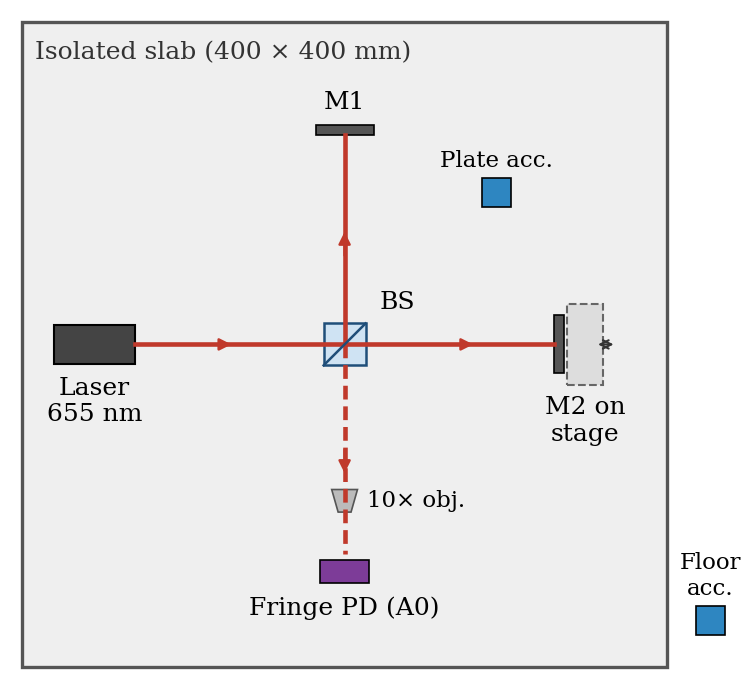
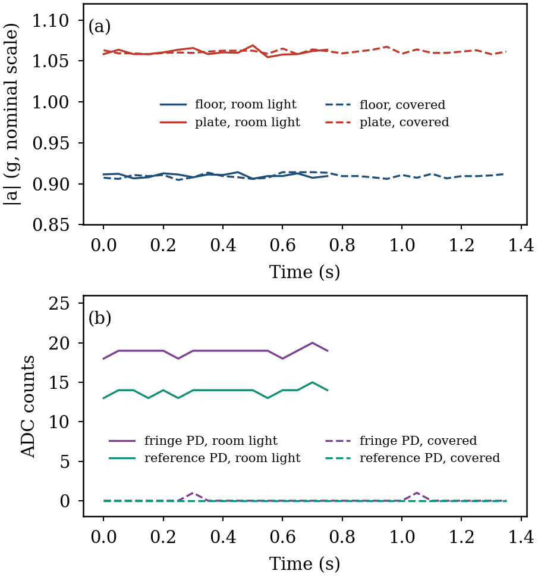

# Michelson Interferometer Vibration Isolation Platform

Arduino firmware and analysis for a low-cost passive vibration-isolation platform, characterised with a Michelson interferometer and dual ADXL345 accelerometers. Groundwork for quantum hardware laboratory infrastructure.

## Status
- Sensors wired and commissioned (October 2026)
- Optics alignment and vibration tests in progress

## Hardware
- Granite slab (400 x 400 mm) on interchangeable isolators
- 655 nm, 5 mW diode laser; 25.4 mm 50:50 cube beamsplitter (Thorlabs BSH1/M)
- Two 25.4 mm mirrors in Thorlabs KM100 mounts; M2 on an LGX40-C translation stage
- Two OPT101 photodiodes (fringe and reference) on A0 and A1
- Two ADXL345 accelerometers on I2C: floor 0x53, plate 0x1D
- Arduino Uno

## Firmware
| Sketch | Purpose |
|---|---|
| `firmware/rig_test/rig_test.ino` | Checks both accelerometers and photodiodes, prints raw values (Serial Monitor, 115200) |
| `firmware/rig_plot/rig_plot.ino` | Labelled output for the Arduino IDE Serial Plotter (115200) |

## Data
Commissioning records and charts are in `analysis/`.

## Author
Alex Duffield, School of Engineering, Macquarie University
